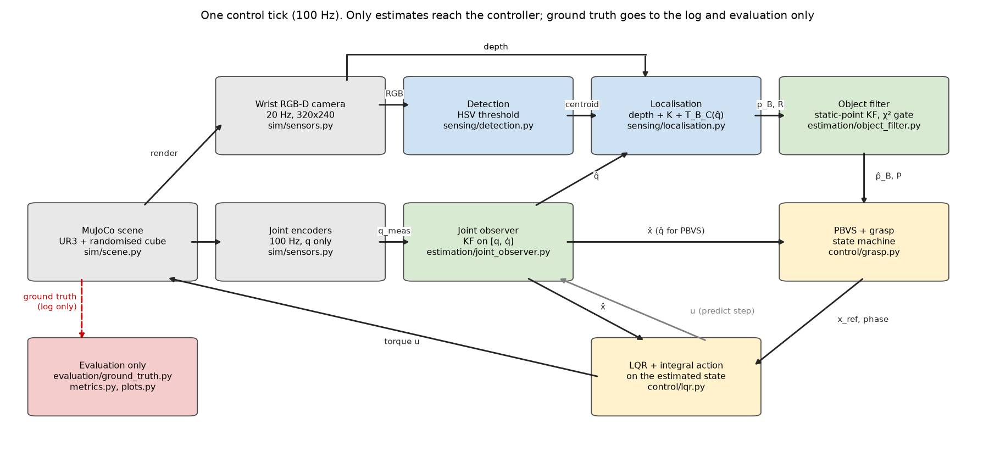
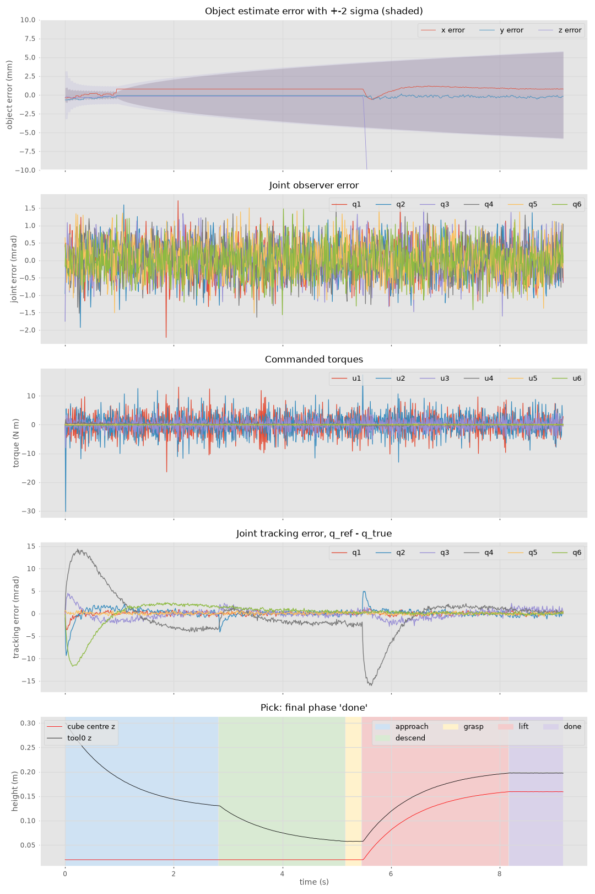
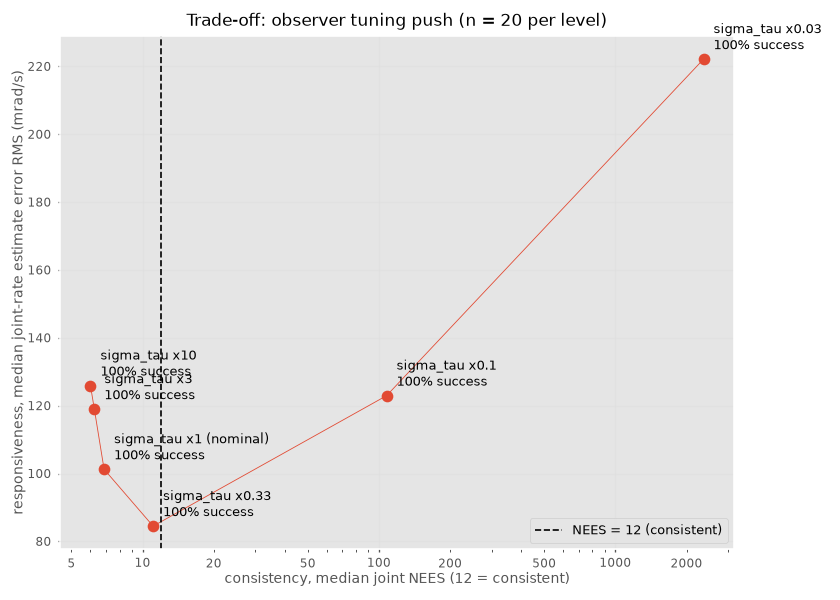
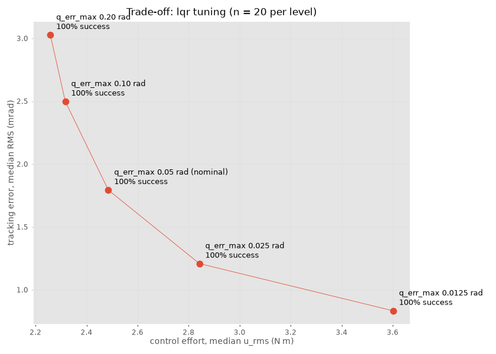

# UR3 vision-guided pick in MuJoCo

**41014 Sensors and Control, Integrated Project, Track B (manipulator: vision-guided pick)**

- Group: 2
- Team: Patrick Blampied, Isaac Silva, Rayann Doha, Nathan Whibley
- Repository: https://github.com/patrock1/Sensors-and-Controls
- Demo video (5 min): TODO link

## Overview

A simulated UR3 arm with a wrist-mounted RGB-D camera finds a red cube placed at a random position and yaw on a table, works out where it is from the depth image, and picks it up. Nothing in the controller sees the true state of the simulator: joint angles come from noisy encoders through a Kalman filter (joint velocities aren't measured at all), and the cube position comes from the camera through a second filter. Ground truth is only used afterwards to score the trials.



## 1. Results at a glance

Final evaluation is 50 held-out seeds (100 to 149), with the cube position and yaw randomised every trial. A trial counts as a success based on ground truth, not on what the state machine reports: the cube has to end up at least 0.10 m above the table and within 0.03 m of the tool.

| Metric | Result |
|---|---|
| Success | 50 / 50 (100 %), 95 % Wilson interval 93 to 100 % |
| Object error when the arm commits to the grasp (median) | 0.68 mm (xy 0.62 mm, z -0.23 mm) |
| Object error, 90th percentile | 2.2 mm |
| Time to grasp (median) | 5.10 s |
| Joint NEES (median, 12 = consistent) | 6.6 |
| Joint tracking error, RMS (median) | 1.80 mrad |
| Joint velocity estimate error, RMS (median) | 94 mrad/s |
| Torque, RMS (median) | 2.5 N m |
| Trials where the state machine and ground truth disagreed | 0 |

From `results/summary/nominal_eval.json` (`python scripts/run_trials.py --seeds eval`).

- All tuning was done on the dev seeds (0 to 9). The eval seeds were only run once tuning was frozen.
- Final runs were on MuJoCo 3.10.0 on an Intel Mac. A 10-seed check matched Linux / MuJoCo 3.15.0 to 0.1 mm, and rerunning every sweep gave identical numbers.
- The worst object errors were seeds 106 (8.7 mm) and 132 (8.3 mm), still well inside the 20 mm the gripper can absorb.
- NEES below 12 means the joint filter is slightly conservative (it reports more uncertainty than it actually has). See Part C.



## 2. Install and run

```bash
git clone https://github.com/patrock1/Sensors-and-Controls
cd Sensors-and-Controls
python3.12 -m venv .venv
source .venv/bin/activate          # Windows: .venv\Scripts\activate
pip install -r requirements.txt
python -m scripts.build_ur3_model  # generates models/ur3/ur3.xml, needed before anything runs
python -m pytest -q
```

Intel Macs: MuJoCo 3.15.0 doesn't have an Intel macOS build, so install everything else and then 3.10.0 (the project doesn't use anything newer):

```bash
grep -v '^mujoco==' requirements.txt > /tmp/req-mac.txt
pip install -r /tmp/req-mac.txt mujoco==3.10.0
```

macOS also prints an `ARB_clip_control unavailable` warning about depth precision. At the 0.2 to 0.4 m working range it made no measurable difference.

| Command | What it does |
|---|---|
| `python scripts/view.py` | MuJoCo viewer of the scene (no controller running) |
| `python scripts/demo.py --seed 3 --out results/demo.mp4` | One full pick as a video plus a plot |
| `python scripts/run_trials.py --seeds eval` | The 50-seed evaluation in Section 1 (about 3 min) |
| `python scripts/run_sweep.py <name>` | One sweep: `disturbance`, `noise_levels`, `calibration_error`, `lqr_tuning`, `observer_tuning`, `observer_tuning_push` (about 6 to 16 min each) |
| `python -m scripts.design_report` | Prints the design numbers for Parts A, C and D |
| `python scripts/calibrate_camera.py` | Camera intrinsics fitted from 40 views (Part B) |
| `python scripts/check_localise.py --n 20` | Localisation error over 20 seeds (Part B) |
| `python scripts/make_figures.py` | Regenerates the figures |

Every trial is seeded, so the same code on the same machine gives the same numbers.

All tunable values are in `configs/default.yaml`.

## 3. Pipeline and frames

Every 10 ms control tick:
1. sensors give noisy encoder angles (every tick) and an RGB-D frame (every 5th tick, so 20 Hz)
2. joint observer predicts with the last torque and updates with the encoder angles
3. on camera ticks: colour detection, depth back-projection, transform into the base frame using the *estimated* joint angles
4. object filter updates the cube position (with a gate to throw out bad measurements)
5. PBVS + grasp state machine turns the cube estimate into a joint reference
6. LQR computes torques from the estimated state and the reference

Ground truth is kept out structurally: `sim/sensors.py` is the only way into the pipeline, `evaluation/ground_truth.py` is the only thing that reads true state, and `tests/test_no_ground_truth.py` fails if any sensing/estimation/control module imports the simulator.

| Frame | Meaning |
|---|---|
| `B` | Robot base and world frame. Origin at the base on the table, z up, table top at z = 0 |
| `T` | Tool frame (`tool0` site), z along the approach direction |
| `C` | Camera frame, OpenCV convention (x right, y down, z forward) |
| `O` | Object frame, origin at the cube centre |

From a pixel to the torque:

```
pixel (u, v) + depth Z  ->  p_C = Z * inv(K) * [u, v, 1]
p_C  ->  p_B = T_B_T(q_hat) * T_T_C * p_C  ->  minus half the cube height (top face to centre)
p_B  ->  object filter  ->  PBVS target  ->  LQR torque
```

`q_hat` is the observer's estimate, never the true joint angles. Details and checks in `docs/part_b_sensing.md`.

## 4. Part A: Modelling

Full write-up: `docs/part_a_modelling.md`

- Each joint modelled as `M q̈ + b q̇ = τ`, 12 states (q and q̇), torques in, encoder angles out, discretised with ZOH at 10 ms
- M read from MuJoCo at the home pose, b matches the MJCF damping
- Assumptions: gravity cancelled by the sim's gravity compensation, inertia fixed at the home pose, joint coupling
- First design used only the diagonal of M (joints treated as independent). Joints 2 and 3 are strongly coupled and this caused the joint 3 oscillation in Section 9. Final design uses the full inertia matrix.
- Controllable and observable per joint and for the full system. Encoders alone make it observable, tachometers alone don't, so velocity has to be estimated (Part C)

TODO: check this matches the final Part A doc

## 5. Part B: Sensing, calibration and frames

Full write-up: `docs/part_b_sensing.md`

- Noise models: encoder noise, depth noise that grows with distance, dropped frames. The same values are used to build R, so R isn't hand-tuned
- Camera intrinsics from the field of view, checked against a fit over 40 views
- Depth sees the top face of the cube, not the centre, which gave a 20 mm bias. Fixed by shifting down half the cube size
- Noise sources: `sigma_q` = 0.5 mrad assumes a 13-bit encoder (one count is 0.77 mrad), depth noise uses the Week 4 RGB-D model `sigma_d = a + b * Z^2`

## 6. Part C: Estimation

TODO: link Part C write-up once it exists

- Joint observer: linear KF on [q, q̇], only q measured. R from encoder noise, Q from an unmodelled torque sigma_tau
- Object filter: cube treated as static (small random walk), 99 % chi-square gate, estimate frozen once the arm starts to descend
- Consistency checked with NEES (12 = consistent for 12 states)
- Trade-off: consistency vs responsiveness. `sigma_tau` (the unmodelled torque the filter allows for) was scaled from x0.03 to x10, once with no disturbance and once with a 40 N push.

| sigma_tau | x0.03 | x0.1 | x0.33 | **x1 (used)** | x3 | x10 |
|---|---|---|---|---|---|---|
| NEES, nominal | 8.1 | 6.5 | 6.8 | **6.6** | 6.2 | 6.0 |
| NEES, 40 N push | 2360 | 108 | 11.1 | **6.9** | 6.2 | 6.0 |
| Velocity estimate error, nominal (mrad/s) | 10 | 23 | 60 | **94** | 115 | 122 |
| Velocity estimate error, push (mrad/s) | 222 | 123 | 85 | **101** | 119 | 126 |
| Torque RMS, nominal (N m) | 0.5 | 0.6 | 1.2 | **2.5** | 4.2 | 4.9 |

  - Too small and the filter trusts its model too much: fine when nothing happens, badly overconfident when the arm gets pushed (NEES in the hundreds to thousands).
  - Too large and it trusts the noisy encoders too much: always consistent, but encoder noise goes straight into the velocity estimate and the torque.
  - x0.33 is the best balance (NEES 11.1 under a push, close to the ideal 12, and half the torque noise). We kept x1 because it was tuned on the dev seeds, and switching to a value picked from this eval-seed sweep would be tuning on the test set. x1 is consistent everywhere, just conservative. x0.33 is the recommended next step.
  - Why x1 ended up conservative: it was raised 3x during tuning to fix very high NEES (98). That was before the joint 3 oscillation was fixed (Section 9), and the oscillation was most likely what drove the NEES up: once it was fixed, NEES dropped from 12.2 to 6.6 on average with no observer change, and the extra margin was no longer needed.

  
- The gate doing real work: late in the approach the cube starts leaving the image, raw measurements get much worse, and the gate rejects them so the estimate stays good

## 7. Part D: Control

TODO: link Part D write-up once it exists

- Cascade: PBVS outer loop makes a joint reference, LQR inner loop tracks it
- Grasp state machine: search → approach → descend → grasp → lift → done, with timeouts
- LQR weights from Bryson's rule, integral action on position error, anti-windup when torque saturates
- Trade-off: control effort vs tracking. `q_err_max` (the acceptable position error in Bryson's rule) was varied with everything else fixed:

| q_err_max (rad) | 0.20 | 0.10 | **0.05 (used)** | 0.025 | 0.0125 |
|---|---|---|---|---|---|
| Tracking RMS (mrad) | 3.03 | 2.50 | **1.79** | 1.21 | 0.83 |
| Torque RMS (N m) | 2.3 | 2.3 | **2.5** | 2.8 | 3.6 |

  - Tighter weights buy better tracking with more effort, and every level still succeeds 100 %.
  - 0.05 rad sits at the knee: going from 0.20 to 0.05 rad cuts tracking error by 40 % for about 9 % more torque, but going further to 0.0125 rad costs another 44 % torque. The tracking error at 0.05 rad (1.8 mrad, under 1 mm at the tool) is already much smaller than the object estimate error, so tighter tracking wouldn't improve the grasp.

  
- Estimator vs controller speed. TODO: explain the ratio

## 8. Part E: Integration and robustness

Full write-up: `docs/part_e_robustness.md`

- Disturbances: wrist pushes, camera blackouts, reduced gravity compensation, encoder bias
- Calibration errors: hand-eye offset, focal length
- Sensor noise: filters that know the noise vs filters that don't
- Every failed trial gets a cause automatically (sensing / estimator / undiagnosed)
- TODO: summary of each sweep + figures, updated for the final controller

## 9. Failures found and how they were traced

- Cube fell through the table (collision settings)
- 20 mm localisation bias (depth sees the top face)
- Hand-eye calibration error never applied (sweep gave identical results at every level)
- Joint 3 oscillating at its torque limit ([issue #4](https://github.com/patrock1/Sensors-and-Controls/issues/4), fixed in #10):
  - **Symptom:** on some seeds joint 3 buzzed at 42 to 45 Hz at its 28 N m torque limit during the lift, and joint NEES went as high as 74. Trials still succeeded. A smaller oscillation (about 34 Hz) was actually there on every seed, through the whole trial.
  - **Diagnosis:** the controller and observer were designed treating each joint separately (only the diagonal of the inertia matrix). Joints 2 and 3 are strongly coupled (0.64 at the home pose, 0.79 at the lift pose), so the fast joint 3 motion only "feels" about M33 (1 - coupling^2) of its own inertia: 59 % at home, 38 % at the lift. The velocity gain was already close to correcting the whole error in one 10 ms tick, so with the real, lighter inertia the loop overshoots. Rebuilding the closed loop with the true coupled inertia showed a lightly damped mode at home (|z| = 0.95, about 33 Hz) and an unstable one at the lift pose (|z| = 1.27, about 38 Hz), which grows until the torque saturates.
  - **Fix:** design the controller and observer on the full 6x6 inertia matrix instead of its diagonal, with the same Bryson weights (`modelling.coupled: true`). A heavier torque penalty was also tried, but it only reduced the problem gradually and costs bandwidth.
  - **Before / after** (60 seeds): success 60/60 both; seeds hitting the torque limit 8 -> 0; worst joint 3 torque 28.0 -> 9.8 N m; joint NEES mean / max 12.2 / 74.4 -> 6.6 / 7.0. Grasp time and object error unchanged.

## 10. Limitations

- Nothing checks whether the grasp actually worked
- Cube leaves the camera view late in the approach, so the arm commits to an early estimate
- R doesn't include the uncertainty in the joint estimates
- Observer has no bias state, so encoder bias makes it confidently wrong
- Model linearised at the home pose
- Detection relies on the cube being the only red object
- Simulation only

## 11. Repository layout

```
configs/
  default.yaml        all tunable numbers (noise, filter, LQR, grasp)
  seeds.yaml          dev seeds (0-9, tuning) and eval seeds (100-149, final results)
  sweeps/             one file per robustness / tuning sweep
models/
  scene.xml           table, cube, cameras
  ur3/ur3.xml         generated by scripts/build_ur3_model.py (not committed)
ur3pick/
  sim/                MuJoCo scene, sensors, cube randomisation, disturbances (only way to the simulator)
  modelling/          UR3 parameters, state-space model, controllability/observability
  sensing/            camera calibration, detection, localisation, frames
  estimation/         joint Kalman filter, object filter, NEES
  control/            LQR, PBVS/IBVS, grasp state machine
  evaluation/         ground truth (only place true state is read), metrics, plots
  pipeline.py         one trial: the control loop in Section 3
scripts/              run_trials, run_sweep, demo, design_report, calibration and check scripts, make_figures
tests/                unit tests, including the no-ground-truth import check
docs/                 Part A-E write-ups, interfaces.md (team contract), figures, contributions
results/summary/      committed results (JSON) behind every number in this README
```

## 12. Individual contributions

- Patrick Blampied: see `docs/contributions/patrick.md`
- Isaac Silva: TODO
- Rayann Doha: see `docs/contributions/rayann.md`
- Nathan Whibley: TODO (documentation)

## 13. Generative AI declaration

TODO: each member lists the tools they used and what for (required by the marking guide)

## 14. Acknowledgements

- 41014 weekly tutorial material, adapted to this platform
- MuJoCo, Robotics Toolbox for Python, python-control, OpenCV
