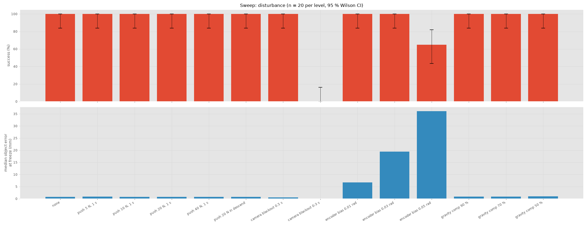
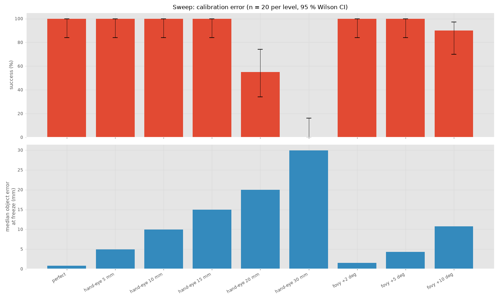
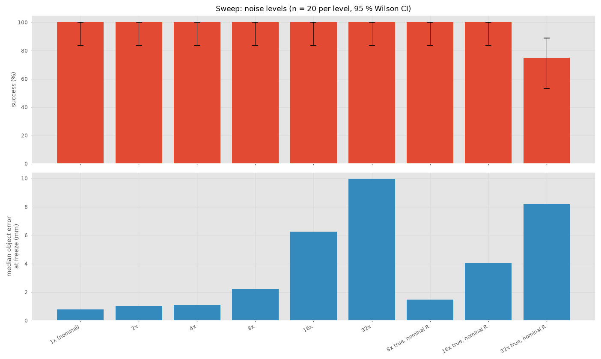

# Part E: Integration and robustness

## Method

Each sweep runs the full pipeline on the 20 eval seeds (100 to 119) at every level, on the final coupled controller (#10). Success is judged from ground truth and not from the state machine: the cube centre must end at least 0.10 m above the table and within 0.03 m of the tool in xy. Success rates are shown with 95 % Wilson intervals because a normal interval breaks down near 100 % with only 20 trials.

All disturbances are injected inside `ur3pick/sim/` (`disturbances.py` and `sensors.py`). The pipeline only sees them through its sensor readings and the arm's response, the same way it would see a real disturbance.

Each failed trial gets a cause from `evaluation/metrics.py`. If the state machine reports its own reason (for example a search timeout) that wins. Otherwise the frozen object estimate is checked against the 20 mm capture radius (half the cube width). If the estimate was further off than that the trial is labelled `sensing` when the raw camera measurements were already about as wrong and `estimator` when the filter made them worse. Anything else stays `undiagnosed` rather than guessed.

Reproduce with:

    python scripts/run_sweep.py disturbance
    python scripts/run_sweep.py noise_levels
    python scripts/run_sweep.py calibration_error

Summaries are saved in `results/summary/sweep_*.json`.

## Disturbances

**Pushes.** A force on the wrist (world y) for 1 s at 5, 10, 20 and 40 N and a 20 N push during the descend phase all give 100 % success. The push clearly reaches the arm. The joint tracking RMS grows from 1.8 mrad with no push to 2.3, 3.5, 6.3 and 12.1 mrad at 5, 10, 20 and 40 N. The torque RMS barely changes (2.5 to 2.9 N m) because the push only lasts 1 s of a trial of about 9 s. Success is unaffected because the object estimate is held in the base frame and the arm settles back onto its path before the grasp. The joint NEES stays at 6.6 to 6.9 under every push, so the observer stays consistent while the arm is being disturbed. The 4 to 5 s push was checked to land fully inside the descend phase on all 20 seeds.

**Camera blackout.** Losing the camera for 0.5 s or for 1 to 3 s gives 100 %. The cube is static and the object filter already has an estimate from the first frames near the home pose. It holds that estimate while no measurements arrive. A blackout from 0 s was dropped from the sweep because it fails by design through the 2 s search timeout and says nothing new.

**Gravity compensation.** Reducing it to 90, 70 and 50 % gives 100 %. The integral action in the LQR absorbs the missing gravity torque. At 50 % the torque RMS rises from 2.5 to 3.7 N m and the tracking RMS from 1.8 to 3.7 mrad.

**Encoder bias.** A constant offset on every encoder gives 100 % at 0.01 rad, 95 % [76, 99] at 0.03 rad and 60 % [39, 78] at 0.05 rad. The object error at 0.05 rad is 36.1 mm which is almost twice the capture radius. Many picks still succeed because the camera is mounted on the wrist. The same biased joint angles misplace the camera and the tool together and the error mostly cancels when the tool moves to where the camera saw the cube. The absolute object error therefore overstates the problem here. The observer has no bias state and its joint NEES median reaches about 69 000 (12 is consistent) which shows it is confidently wrong. The tracking RMS (10.1, 30.0 and 50.0 mrad) equals the bias itself because the arm tracks its biased estimate of the joint angles.

## Calibration error

The hand-eye offset the estimator assumes is moved along the tool x axis while the sim camera stays where it is mounted. The object error follows the offset 1:1 (4.9, 9.9, 14.9, 19.9 and 30.0 mm for 5 to 30 mm). Success is 100 % up to 15 mm, 55 % [34, 74] at 20 mm and 0 % at 30 mm. The failure starts exactly at the 20 mm capture radius. The gripper only catches the cube if its centre is within half a cube width of the tool axis and a hand-eye error moves the tool by the full offset. The hand-eye 30 mm bar is 0 % so only its error bar shows.

A focal length error has a smaller effect. Adding 2, 5 and 10 degrees to the 60 degree field of view gives object errors of 1.5, 4.3 and 10.7 mm. Only +10 degrees causes failures (90 % success, 2 failures labelled `sensing`).

Only translation along tool x was tested. Errors along other axes or in rotation were not.

## Sensor noise

The original levels scale the true noise and the noise values the filters use for R together. With matched noise the system holds 100 % up to 32 * nominal with the object error growing from 0.8 to 9.9 mm. The joint NEES stays between 5.5 and 6.8 at every level, so a filter that knows its noise stays consistent. This is optimistic because the filters always know the true noise level.

To test a filter that underestimates its noise we added `noise.true_scale`. It raises only the noise the sim adds and the filters keep the nominal R. The joint NEES median jumps to about 425, 1680 and 6700 at 8, 16 and 32 * true noise. The overconfident observer passes the encoder noise straight into the commands. The torque RMS rises from 2.5 to 17.7 N m at 8 * while every pick still succeeds, and to 28.8 N m at 32 *. At 32 * success drops to 75 % [53, 89] even though the object error (8.2 mm) is well inside the capture radius. The failures come from the joint state and not from the cube estimate.

## Failure diagnosis

| Level | Success | Cause | Traced to |
|---|---|---|---|
| hand-eye 20 mm | 55 % | sensing 7, undiagnosed 2 | offset at the capture radius |
| hand-eye 30 mm | 0 % | sensing 20 | offset beyond the capture radius |
| encoder bias 0.03 rad | 95 % | sensing 1 | bias not modelled in the observer |
| encoder bias 0.05 rad | 60 % | sensing 8 | bias not modelled in the observer |
| fovy +10 deg | 90 % | sensing 2 | focal length error |
| 32 * true noise, nominal R | 75 % | undiagnosed 5 | joint observer overconfident (NEES about 6700) |

The 2 undiagnosed hand-eye 20 mm failures had object errors just under 20 mm (19.9 mm median) where a small extra error tips the grasp over. The 5 undiagnosed noise failures are estimator failures. The cause rule only checks the object error which was fine in those trials. The joint NEES and the torque RMS trace them to the observer.

In runs without encoder disturbances or noise mismatch the joint NEES median is 6.6, below the 12 of a perfectly consistent filter. The observer is slightly conservative on purpose because its process noise is sized for disturbances. This is why it stays consistent under a 40 N push.

## Limitations

- **No grasp check.** Nothing senses whether the grasp worked after the gripper closes. A failed trial ends with the state machine reporting `done` while the cube is still on the table.
- **The cube leaves the camera view late in the approach.** Raw localisations degrade to about 25 mm and the object filter's chi-square gate rejects them. The arm commits to an estimate made earlier in the approach.
- **The cause rule cannot see estimator failures in the joint state.** It only compares object errors, so the noise-mismatch failures stay `undiagnosed`.
- **The observer has no bias state.** A constant encoder offset makes it confidently wrong.
- **Pixel noise is not added to the image.** `pixel_sigma` only sets R in `localise()`.
- **Everything is in simulation** with a single cube region chosen to be visible from the home pose.

With more time we would add a grasp check after the lift, add a bias state to the joint observer and extend the cause rule to label failures with a very high joint NEES as `estimator`.

## Fixes found during evaluation

- `calibration.hand_eye_error` was never applied. Every hand-eye level ran with perfect calibration and gave identical results. It is now passed from `pipeline.py` through `localise()` to `frames.T_B_C()` on the estimator side only.
- The first sweeps showed joint 3 hitting its 28 N m torque limit even in nominal runs. This was traced to the decoupled model ignoring the shoulder-elbow inertia coupling (issue #4) and fixed in #10 by designing the controller and observer on the full mass matrix. All numbers above are on the fixed controller.
- `scripts/demo.py` needed `imageio` and `imageio-ffmpeg`, which were missing from `requirements.txt`. They were added and the full pipeline was checked from a fresh virtual environment.
